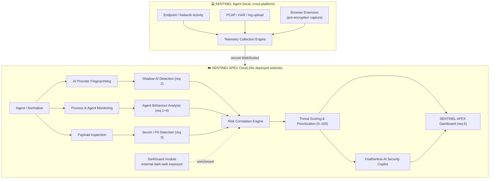

<div align="center">

# 🛡️ SENTINEL APEX

### Discover. Monitor. Investigate. Protect.

**An autonomous AI-security platform that turns scattered endpoint signals into one correlated, scored incident — exposing the Shadow AI, data exfiltration, and rogue-agent activity that security teams are blind to today.**

`HFT26-TEAM-25` · CBIT Hacktoberfest '26 · Track: **AI Security & Data Privacy**
Problem Statement: **AI Shadow IT & Agentic Data Exfiltration Scanner**

> **Development status:** Initial prototype foundation is active; validated feature integration is in progress on this branch.

[Project Status](./docs/PROJECT_STATUS.md) · [Security](./SECURITY.md) · [Contributing](./CONTRIBUTING.md)

[Live Website](#) · [Demo Video](#) · [Architecture](#4-architecture) · [Quick Start](#8-local-setup)

</div>

---

## 📋 Team — The Nice Guys (TEAM-25)

| | Name | Role on this project | Email |
|---|---|---|---|
| 👑 | **Ashish Pardeshi** (Lead) | Correlation engine, Featherless copilot, DarkGuard integration, deploy & demo | ashish.pardeshi24@sanjivani.edu.in |
| 2 | **Vishnu Varma** | Backend & detection engines (FastAPI, secrets, PII, scoring) | deepak.varma24@sanjivani.edu.in |
| 3 | **Saifullah Pathan** | Sensors / local agent (process, packet, agent-behaviour, uploader) | saifullah.pathan24@sanjivani.edu.in |
| 4 | **Shruti Sadgir** | Frontend — SENTINEL APEX Command Center (React dashboard) | shruti.sadgir24@sanjivani.edu.in |

**Team No.** TEAM-25 (HFT26-TEAM-25) · **Reg ID** HFEST26-BSH3C7X8 · **Institution** Sanjivani University, Kopargaon, Maharashtra

> Roles are a starting split — swap to match each person's strengths. See [PLAN.md](./PLAN.md) for the hour-by-hour build timeline.

---

## 1. The problem (why this matters right now)

Employees have wired their daily work into AI tools nobody in security approved: public chatbots, browser AI extensions, local LLMs, and autonomous coding agents. They paste source code, customer records, credentials, and internal docs into them dozens of times a day. Security sees none of it, because the leak never passes through one gateway they can watch.

This is **Shadow AI**, and the numbers moved fast:

- Shadow AI was a factor in **43% of breached organizations in 2026, up from 20%** a year earlier ([IBM](https://enterprisedna.co/resources/news/ibm-cost-of-data-breach-2026-ai-enabled-shadow-ai-enterprise-security/)); unapproved AI tools added about **$670,000** to the average breach ([IBM Think](https://www.ibm.com/think/x-force/2025-cost-of-a-data-breach-navigating-ai)).
- **~40% of what employees send to AI tools now contains sensitive data**, up from 11% in 2023 ([Cyberhaven Labs 2026](https://www.cyberhaven.com/blog/insider-threats-in-the-age-of-ai)). Unsanctioned-AI use **tripled, 15% → 45%**, in a year ([Verizon 2026 DBIR](https://guptadeepak.com/ciso/benchmarks/shadow-ai-employee-usage/)).
- **175,000+ local Ollama servers** sit open on the internet with no auth ([SentinelOne + Censys](https://www.sentinelone.com/labs/silent-brothers-ollama-hosts-form-anonymous-ai-network-beyond-platform-guardrails/)). Autonomous agents are a live exfiltration path — **s1ngularity** weaponized local AI CLIs to harvest secrets to public repos ([Nx](https://nx.dev/blog/s1ngularity-postmortem)).
- In India, breach costs hit a record **₹25.5 crore** ([IBM India](https://in.newsroom.ibm.com/India-Records-its-Highest-Average-Cost-of-a-Data-Breach-2026)), and **DPDP Rules 2025** carry penalties up to **₹250 crore** ([Grant Thornton](https://www.grantthornton.in/globalassets/1.-member-firms/india/assets/pdfs/flyers/dpdp-rules-nov-2025.pdf)). An Aadhaar pasted into a chatbot is now a compliance event.

A prompt wrapper or one "guardrail LLM" cannot solve this — the leak has no single chokepoint. **You have to watch the endpoint itself, and connect what you see.**

> *Statistics paraphrased from the linked sources and rounded for readability.*

---

## 2. Our approach — correlation, not just detection

Most data-loss tools spray disconnected alerts and the analyst drowns. **SENTINEL APEX fuses five signals into one scored incident:**

> *An unapproved AI provider (**where**) + the responsible process (**who**) + a leaked secret/PII in the payload (**what**) + risky agent file/shell activity (**how**) + whether it's already exposed externally (**so what**) → one incident, one 0–100 score, one AI-written explanation.*

Three things make it stand out:

1. **Pre-encryption capture beats "no SSL decryption."** We read a browser AI prompt *inside the browser, before TLS*, so we never decrypt traffic yet still see the payload even when [Encrypted Client Hello](https://support.mozilla.org/en-US/kb/understand-encrypted-client-hello-redirect-3) hides the destination.
2. **Left of boom + right of boom.** SENTINEL APEX catches a leak *as it happens*; our integrated **DarkGuard** module reports what has *already* leaked to the dark web. One platform, both halves of the timeline.
3. **Deterministic core, LLM for judgment.** Detection and scoring are deterministic and reproducible; the Featherless LLM only explains and recommends — it never silently decides a leak occurred.

---

## 3. How it ships: one website + a lightweight local agent

Endpoint sensing is inherently local, but the product is a **live-deployed website**. We reconcile both with a standard SaaS-agent split:

- **☁️ SENTINEL APEX Cloud (the website)** — the React Command Center, the FastAPI correlation/scoring/copilot backend, and the **DarkGuard** threat-intel portal. Deployed and reachable by URL. This is what judges open.
- **💻 SENTINEL Agent (local)** — a small cross-platform Python agent (the sensors) that runs on the monitored machine and streams normalized events to the cloud backend over secure WebSocket. Download-and-run; no enterprise rollout.

Runs on **Windows, Linux, and macOS** (psutil is cross-platform; packet capture uses Npcap on Windows / libpcap elsewhere; the browser extension targets Chrome, Edge, Brave, Firefox).

---

## 4. Architecture



Engine-to-requirement mapping and the full `event → incident` data model are in the sections below.

| Engine | Does | PS req |
|---|---|---|
| **Telemetry Collection** | One ingestion point: live process/network telemetry, uploaded PCAP/HAR/logs, browser-captured prompts → one event schema | 1 |
| **AI Provider Fingerprinting → Shadow AI Detection** | Resolve each connection to a known AI provider (cloud host / local LLM port); classify `approved`/`unapproved`/`unknown` | 2 |
| **Process & Agent Monitoring → Agent Behaviour Analysis** | Attribute connections to processes; flag agents spawning shells, reading `.env`/SSH keys, or `--dangerously-skip-permissions` flags | 1, 4 |
| **Payload Inspection → Secret / PII Detection** | Secrets (regex + Shannon entropy) + PII (Presidio + India recognizers); redact locally | 3 |
| **Risk Correlation** | Group related findings (same process/host/window) into one incident — **the differentiator** | 5 |
| **Threat Scoring** | 0–100 from data sensitivity, approval status, agent permissions, confidence, external exposure | 5 |
| **Featherless Copilot** | Explain a masked incident, write remediation, answer analyst questions from recorded evidence | Featherless |
| **Dashboard** | Local, privacy-first command center (the website) | 5 |

---

## 5. Data model — from events to one incident

```jsonc
// EVENT — emitted by any source, normalized by Telemetry Collection
{
  "id": "evt_01H...", "ts": "2026-10-30T20:14:05+05:30",
  "source": "browser",                 // process | packet | browser | agent | upload
  "host": "LAPTOP-07", "user": "dev01",
  "process": { "name": "chrome.exe", "pid": 8123 },
  "destination": { "host": "api.openai.com", "port": 443, "provider": "OpenAI", "approval": "unapproved" },
  "payload_excerpt": "prod config: AWS_SECRET=\u2588\u2588\u2588\u2588",
  "findings": [
    { "type": "secret", "label": "AWS Secret Key", "severity": "critical", "confidence": 0.98 },
    { "type": "pii", "label": "Aadhaar", "severity": "high", "confidence": 0.95 }
  ],
  "behavior": []
}

// INCIDENT — produced by the Risk Correlation Engine
{
  "incident_id": "inc_01H...",
  "title": "Unapproved AI tool received an AWS key + Aadhaar from chrome.exe",
  "event_ids": ["evt_01H...", "evt_01H..."],
  "signals": {
    "shadow_ai": "OpenAI (unapproved)", "process": "chrome.exe (pid 8123)",
    "data_leak": ["AWS Secret Key", "Aadhaar"], "agent_behavior": null,
    "external_exposure": { "source": "DarkGuard", "exposure_score": 72 }
  },
  "risk": { "score": 91, "level": "critical" },
  "ai_explanation": "An unsanctioned cloud AI endpoint received a live AWS secret and an Aadhaar from a browser process. Rotate the key, purge the chat, review DPDP exposure.",
  "remediation": ["Revoke AWS key", "Block api.openai.com for this host", "File DPDP incident note"]
}
```

---

## 6. Tech stack

| Layer | Technology |
|---|---|
| Local agent | Python 3.11 · `psutil` · `scapy` + Npcap/libpcap · `pyshark` · `haralyzer` |
| Browser extension | Manifest V3 · `chrome.webRequest` + content script (Chrome/Edge/Brave/Firefox) |
| Backend | Python **FastAPI** + Uvicorn · WebSockets |
| Detection | regex + Shannon entropy · [Microsoft Presidio](https://github.com/microsoft/presidio) + custom India recognizers (Aadhaar/Verhoeff, PAN, UPI) |
| Correlation & scoring | deterministic rules + weighted risk model |
| AI copilot | [Featherless API](https://featherless.ai/docs/api-overview-and-common-options) (OpenAI-compatible), `temperature: 0`; local Ollama fallback |
| Threat intel | **DarkGuard** module (HIBP, XposedOrNot, paste dumps, Tor/OnionSearch) |
| Frontend | React 18 + Vite + TypeScript · Tailwind CSS · Recharts |
| Data | SQLite (hackathon build) · PostgreSQL-ready (production) |
| Deploy | Dashboard → Vercel · Backend + DarkGuard → Render/Railway · Docker Compose for local |

**AI endpoint catalog (starter):** OpenAI `api.openai.com`, Anthropic `api.anthropic.com`, Gemini `generativelanguage.googleapis.com`, Cursor `*.cursor.sh`, GitHub Copilot `api.githubcopilot.com`, Hugging Face `huggingface.co`; local — Ollama `:11434` (plain HTTP), LM Studio `:1234`, Jan `:1337`, llama.cpp `:8080`, vLLM `:8000`.

---

## 7. Project structure (official `HFT26-TEAM-25` layout)

```
HFT26-TEAM-25/
├── src/
│   ├── backend/        FastAPI: engines, correlation, scoring, copilot, darkguard bridge
│   ├── sensors/        SENTINEL Agent: process · packet · agent · uploader
│   ├── extension/      MV3 browser extension
│   ├── dashboard/      React Command Center (the website)
│   └── darkguard/      ← DarkGuard folder (pre-existing, attributed component)
├── docs/               architecture diagrams, slides, this analysis
├── tests/              detection unit tests + reproducible PS scenarios
├── samples/            sample.pcap · sample.har · requests.jsonl
├── README.md
└── LICENSE             MIT
```

---

## 8. Local setup

**Prerequisites:** Python 3.11, Node 18+, [Npcap](https://npcap.com/#download) (Windows: tick *loopback* + *WinPcap-compatible*; Linux/mac use libpcap), optionally [Ollama](https://ollama.com/) as a demo-safe local AI target.

```bash
# Backend (the cloud API, run locally for dev)
cd src/backend
python -m venv .venv && . .venv/bin/activate      # Windows: .\.venv\Scripts\Activate.ps1
pip install -r requirements.txt
python -m spacy download en_core_web_lg
uvicorn app.main:app --reload --port 8000

# Dashboard (the website)
cd ../dashboard && npm install && npm run dev       # http://localhost:5173

# SENTINEL Agent (sensors) — point it at the backend
cd ../sensors
python -m process_sensor.run
python -m agent_sensor.run

# Demo-safe path (no admin, no live traffic)
python -m uploader.run --file ../../samples/sample.har
```

`src/backend/.env`:
```
FEATHERLESS_API_KEY=your_key
FEATHERLESS_MODEL=Qwen/Qwen2.5-Coder-32B-Instruct
DARKGUARD_API_BASE=https://capable-quietude-production.up.railway.app/api
ORG_ALLOWLIST=api.openai.com
```

---

## 9. How this maps to the problem statement

| PS requirement | Where it lives |
|---|---|
| 1 · Passively inspect process connections **or** ingest PCAP/HTTP logs | Telemetry Collection (process sensor + uploader) |
| 2 · Identify AI providers / local LLM servers (hostnames, ports like 11434) | AI Provider Fingerprinting → Shadow AI Detection |
| 3 · Entropy + regex secret and PII detection in payloads | Payload Inspection → Secret / PII Detection |
| 4 · Flag risky autonomous-agent behavior (shell, file reads) | Process & Agent Monitoring → Agent Behaviour Analysis |
| 5 · Local, privacy-focused dashboard (usage, alerts, risk score) | Correlation + Scoring + Dashboard |
| Suggested Featherless usage · LLM triage + remediation | Featherless AI Security Copilot |

**Beyond the ask:** correlation-to-single-incident, DarkGuard external-exposure enrichment, India/DPDP-aware PII, pre-encryption browser capture, alerts mapped to real 2026 incidents.

---

## 10. Submission workflow (fork + PR)

This repo is a fork of the official `HFT26-TEAM-25` upstream. We develop on `feature/prototype` and submit via Pull Request — **never** push to upstream `main`.

```bash
git clone https://github.com/<your-username>/HFT26-TEAM-25.git
cd HFT26-TEAM-25 && git checkout -b feature/prototype
git add . && git commit -m "feat: SENTINEL APEX correlation engine"
git push origin feature/prototype
```

**PR title:** `[SUBMISSION] TEAM-25 - The Nice guys - AI Shadow IT & Agentic Data Exfiltration Scanner`
*(update the starter's "Track Selection in Progress" to the locked track above)*

**PR description checklist:** 📌 Solution overview · 🏗️ Architecture & tech stack · 🚀 Setup · 🎥 Demo video / live URL · 📸 Screenshots.

---

## 11. Attribution & provenance

- **SENTINEL APEX platform** (telemetry agent, detection engines, Risk Correlation Engine, scoring, Featherless copilot, dashboard, and all integration code) is **original work built during CBIT Hacktoberfest '26**.
- **DarkGuard** (`src/darkguard/`) is the team's **pre-existing open-source project** ([darkguard.in](https://darkguard.in)), included as an attributed component under its own license and wired in as the external threat-intelligence module. It is clearly marked as prior work.
- Open-source libraries (FastAPI, Presidio, scapy, React, etc.) are used under their respective licenses.

---

## License

MIT — see [LICENSE](./LICENSE). Built for CBIT Hacktoberfest '26, theme *AI Belongs to Everyone*.

## Sources

[IBM 2026](https://newsroom.ibm.com/2026-07-29-ibm-study-one-in-four-malicious-breaches-are-ai-enabled,-costing-companies-6-million-on-average) · [IBM 2025](https://www.ibm.com/think/x-force/2025-cost-of-a-data-breach-navigating-ai) · [IBM India](https://in.newsroom.ibm.com/India-Records-its-Highest-Average-Cost-of-a-Data-Breach-2026) · [Cyberhaven 2026](https://www.cyberhaven.com/blog/insider-threats-in-the-age-of-ai) · [Verizon 2026 DBIR](https://guptadeepak.com/ciso/benchmarks/shadow-ai-employee-usage/) · [SentinelOne + Censys](https://www.sentinelone.com/labs/silent-brothers-ollama-hosts-form-anonymous-ai-network-beyond-platform-guardrails/) · [Nx s1ngularity](https://nx.dev/blog/s1ngularity-postmortem) · [DPDP Rules 2025](https://www.grantthornton.in/globalassets/1.-member-firms/india/assets/pdfs/flyers/dpdp-rules-nov-2025.pdf) · [Featherless](https://featherless.ai/docs/api-overview-and-common-options) · [Presidio](https://github.com/microsoft/presidio) · [Npcap](https://npcap.com/).

*All third-party content is paraphrased and cited; figures rounded for readability.*
