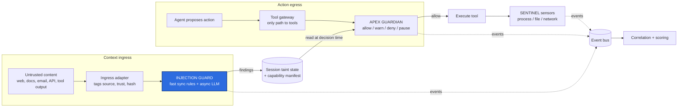

# APEX INJECTION GUARD: Module and Architecture Update

Oct 30, 2026 · @saif

## Summary

APEX INJECTION GUARD becomes a core module of SENTINEL APEX that detects prompt injection in untrusted content and feeds that signal to APEX GUARDIAN, which alone decides whether an agent action runs. The design decision that shapes everything: Injection Guard is a **signal producer at context ingress**, never a gate, and Guardian is the **only decision authority at action egress**.

- **What it adds:** injection detection on content entering an agent, objective-deviation checks against a declared task manifest, and a shared session taint state.
- **How it protects:** a suspicious finding tightens Guardian's deterministic policy for that session, so a missed detection still leaves the baseline policy in force.
- **What it extends:** the existing correlation engine gains a cause chain from untrusted content to attempted action to policy decision to sensor events.
- **What it does not claim:** it reduces risk for agents routed through the tool gateway. It does not stop all prompt injection, and for unmanaged tools it only detects and contains.

## Where it fits

Injection Guard sits on the content path before the agent and writes to a shared session state, while Guardian sits on the tool path after the agent and reads that state.



The highlighted box is the new module. A finding raises the session's taint score, and Guardian reads that score at the tool gateway to tighten its policy, so a missed detection still leaves the baseline policy in force.

## Core architectural decision: two integration points

The module touches the system at exactly two points, and the separation between them is the property that makes the design defensible.

| Point | Component | Role |
|-------|-----------|------|
| **Context ingress** (content entering the agent) | Injection Guard | Tag provenance and trust level, scan for injection, emit findings. Never blocks on its own. |
| **Action egress** (tool call leaving the agent) | Guardian via tool gateway | Sole decision authority: allow, warn, deny, pause. |

The link between them is a **session taint state**, not a verdict handed down a pipeline:

- A suspicious finding marks the session tainted, with a score and the content hash that caused it.
- Guardian's deterministic policy tightens for tainted sessions — for example: sensitive reads denied, egress allowlist only, shell requires approval.
- If the detector misses an injection, the baseline policy still protects the session. Detection tightens enforcement; it never replaces it.

## Session Registry and capability manifest

This is the piece that turns "objective deviation" from an LLM guess into a deterministic check.

Each employee task registers in a **Session Registry** with a **capability manifest** that declares what the task is allowed to touch:

- allowed file paths and tools
- allowed network hosts
- trust level per content source

With the manifest in place, an action that falls outside it is a deterministic violation. An LLM comparing the task text to the action can only add an explanation, because — as the original proposal notes — it cannot establish intent on its own. The manifest is the boundary; the LLM annotates it.

## Component placement rules

Two rules keep detection and enforcement cleanly separated:

- **`action_validator.py` lives in `guardian/`, not in `injection_guard/`.** Validation is an enforcement concern. Keeping it inside Injection Guard would break the rule that detection and enforcement stay separate.
- **`objective_monitor.py` stays in `injection_guard/` but emits a signal, not a decision.** It reports deviation against the manifest; Guardian decides what to do about it.

The `validate_action` entry point takes **taint as an input** alongside the action and the manifest, so detection raises the bar on policy rather than substituting for it:

```python
def validate_action(action, manifest, taint) -> PolicyDecision:
    # Baseline policy always applies, regardless of taint.
    decision = base_policy.evaluate(action, manifest)

    # Taint tightens, never loosens.
    if taint.score >= TAINT_THRESHOLD:
        decision = decision.tighten(
            deny_sensitive_reads=True,
            egress="allowlist_only",
            shell="requires_approval",
        )
    return decision  # allow | warn | deny | pause
```

Guardian gates on the returned `PolicyDecision` only. Taint changes the decision; it is never itself the decision.

## Two operating modes, stated honestly

The level of protection depends on how the agent reaches its tools, and every incident is labelled with the mode that produced it.

| Mode | What it sees | What it can do |
|------|--------------|----------------|
| **Gateway mode** | Agents routed through the tool gateway | Real **pre-execution** protection: allow, warn, deny, pause before the tool runs. |
| **Observe mode** | SENTINEL sensors only (process, file, network) | **Detection and containment after the fact.** Never prevention. |

Gateway mode is where the module earns the word "protect." Observe mode is honest about its limit: it catches and contains, but the action has already happened.

## Latency and failure behaviour

- **Cheap rules run synchronously** at ingress so an obvious injection raises taint before the agent acts on the content.
- **LLM analysis runs asynchronously** and can raise taint after the fact; a later action in the same session then meets the tightened policy.
- **Fail-closed at the gateway** for sensitive resources if the policy engine is unreachable. A reachability failure must not become an implicit allow for `.env`, keys, or egress.

## Event schema additions

New event types, all carrying `session_id`, give the correlator a cause chain instead of a time window:

| Event | Key fields |
|-------|------------|
| `CONTENT_INGESTED` | source, trust_level, content_hash |
| `INJECTION_SUSPECTED` | score, matched indicators, content_hash |
| `ACTION_PROPOSED` | action_id, tool, arguments (redacted) |
| `POLICY_DECISION` | action_id, decision, policy version, taint state at decision time |
| `ACTION_RESULT` | executed or denied, linked sensor events |

Correlation joins `content_hash → finding → action_id → decision → sensor events → secret fingerprints`. That produces a single incident with a cause chain, not just a cluster of events that happened close together.

## Scoring changes

Add declarative rules and separate **outcome** from **attempt**:

- New rules, for example: `injection_in_untrusted_source`, `objective_deviation`, `denied_at_gateway`.
- A blocked attempt is still an incident worth reviewing, but its status is **Contained**, not **Exposed**.
- The breakdown shows both the attempt and its outcome, each citing the event IDs that fired the rule.

## Smallest build that proves it

The minimum demonstrable slice, including a negative control:

1. A toy agent with three tools — `read_file`, `http_get`, `run_shell` — all called through the gateway.
2. A synthetic webpage fixture carrying an indirect injection.
3. A rule-based detector first, with the LLM as an optional extra.
4. A Guardian policy in YAML that denies `.env`, plus a tightened tainted-session mode.
5. One incident rendered with the full dashboard fields.
6. **Negative case:** the same agent on a clean page — no injection, no incident.

## Claims to keep honest

- Say the module **reduces risk**, not that it "stops prompt injection." The boundary is the manifest and the gateway, not the detector.
- Distinguish the 2025 paper's findings from your own engineering extensions, and confirm the citation (title and details) before it goes on a slide.
- For measured numbers, consider public agent-injection benchmarks such as AgentDojo or InjecAgent (verify they fit the setup) alongside your own fixtures. Claim no number until it is measured.
- Define **APEX REDLAB** (a scenario and attack-replay harness fits the role it plays in the hierarchy) or remove it before it appears unexplained.

## Next steps

Pick the order that unblocks the demo fastest:

- [ ] Add the Session Registry and capability manifest schema.
- [ ] Move `action_validator.py` into `guardian/` and add `taint` to `validate_action`.
- [ ] Draft the Guardian policy YAML: baseline deny for `.env`, plus the tightened tainted-session mode.
- [ ] Implement the synchronous rule-based detector at ingress; wire the async LLM pass to raise taint.
- [ ] Emit the five new event types and extend the correlator to join on `content_hash`.
- [ ] Build the toy-agent scenario with the injection fixture and the clean-page negative control.
- [ ] Render one contained incident end to end on the dashboard.
